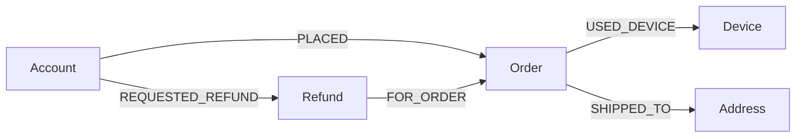
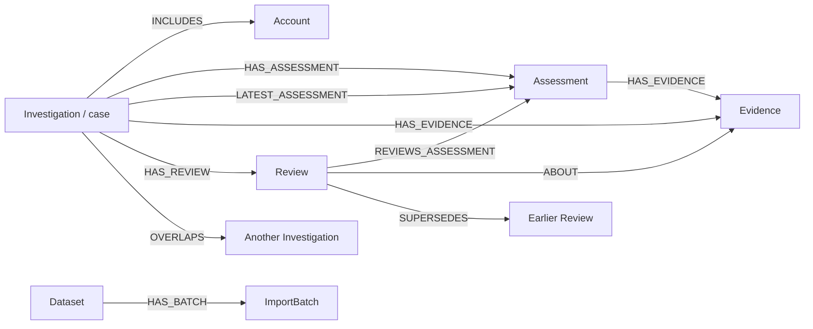
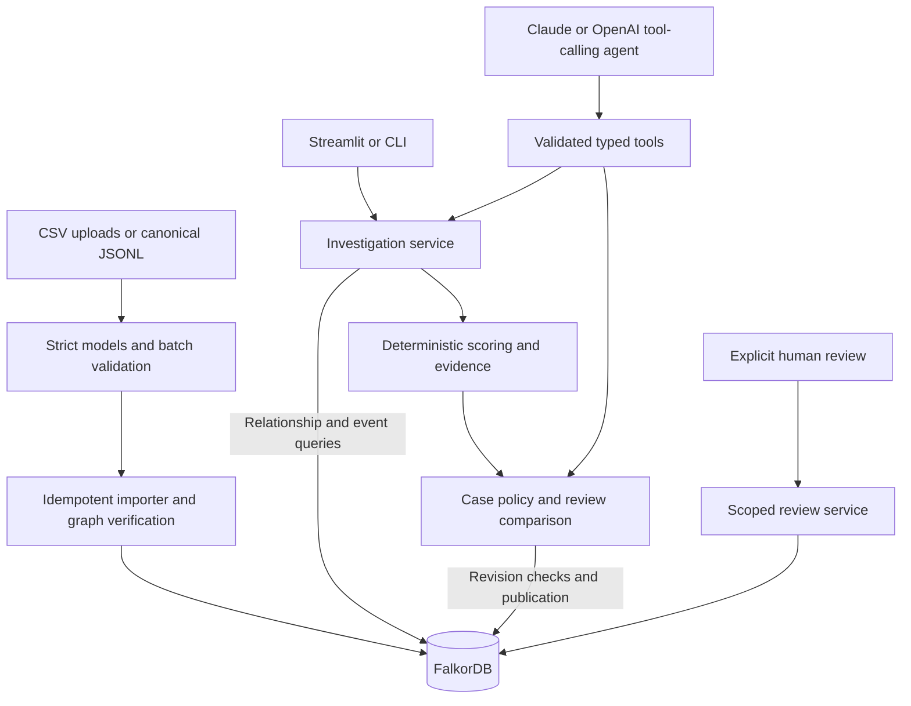

# RingLens

**Turn one refund into a connected, evidence-backed investigation.**

RingLens helps a refund reviewer answer: *“Does this request connect to a pattern
that deserves a closer look?”* It follows accounts, orders and shared devices in
**FalkorDB**, calculates a transparent review priority, and preserves cases and
scoped human decisions. A tool-calling AI agent uses the same validated services
as the dashboard and CLI to investigate and apply case policy.

**[Watch the working demo](https://drive.google.com/file/d/1Fu5IFEkqOOT_te5OYQrvxCbg1GU0Uhty/view?usp=sharing)**
· **[Source repository](https://github.com/ManjariYagnik/GraphHacks)**
· [Run locally](#run-locally)
· [Try the demo](#demo-upload-to-agent-to-saved-case)
· [Graph model and queries](#the-graph-model)
· [Verification](#verification-and-current-status)

| Graph Hacks submission | Details |
| --- | --- |
| Tracks | **Agents That Act on Connected Data**; **Agent Memory and Coordination** |
| Central technology | FalkorDB stores source relationships, import state, cases, evidence, reviews and agent-run audit |
| Interface | Local Streamlit dashboard and Python CLI; no separate API server |
| Data | Deterministic, fully synthetic fixtures; no real customers or addresses |
| Run option | Complete local setup below; public hosting is not needed to reproduce the workflow |
| AI assistance | Developed with OpenAI Codex assistance; [contribution disclosure](#ai-assistance-and-participant-contribution) |

## The problem and the useful difference

A refund row shows an amount, an account and a time. It does not show that the
account shares a device with another customer, who uses a second device connecting
two more accounts. Reviewers need those relationships **and the supporting events**.

RingLens makes that investigation inspectable:

- **Discover:** start at a refund and follow two device expansions in FalkorDB.
- **Explain:** show actual directed paths, source IDs, refund bursts and each
  rule's contribution to the score.
- **Act:** create or revisit a case after completeness, revision and policy checks.
- **Remember:** save what a human reviewed and distinguish those facts from new
  evidence in a later assessment.

The intended users are refund operations teams and investigators. This MVP uses
synthetic data; it makes no claim about measured fraud-detection accuracy, money
saved or reviewer time saved. HIGH means **review priority**, never a probability
or proof of abuse.

## Why FalkorDB is essential

Runtime peers are discovered through stored relationships. RingLens does not load
CSVs, fixture membership or evaluation labels to choose candidate accounts. Python
coordinates queries and performs arithmetic on their results; the displayed graph
is a projection of returned evidence paths.

Removing FalkorDB prevents discovery, source verification, case retrieval and
review-memory lookup. Offline fixture generation and validation can still run,
but an investigation cannot complete. Failed queries and truncated discovery
produce an explicit incomplete result with **no final score or priority**.

A controlled integration test changes device relationships while keeping refund
amounts and timestamps unchanged. The recorded pattern-A comparison changes from
**4 accounts / 90** to **1 account / 0**. This demonstrates that graph relationships
determine the result. See [investigation tests](tests/integration/test_investigation.py)
and [the recorded comparison](docs/investigation.md).

## The graph model



| Source node | Canonical input fields | References represented by edges |
| --- | --- | --- |
| Account | `id`, `created_at` | — |
| Device | `id` | — |
| Address | `id`, `label` | — |
| Order | `id`, `account_id`, `device_id`, `address_id`, `placed_at`, `amount_minor`, `currency` | Account, device and address |
| Refund | `id`, `account_id`, `order_id`, `requested_at`, `amount_minor`, `currency` | Requesting account and order |

Every order has one account, device and address. Every refund has one requester
and order; the requester must own that order. Device use goes through an order so
`placed_at` supplies its timing. Addresses support evidence but are not traversal
links for discovering accounts.

IDs use `acct_`, `dev_`, `addr_`, `ord_` and `ref_` prefixes. Event timestamps are
integer UTC Unix seconds. Amounts are positive integer INR minor units:
`12345` means **INR 123.45**. Each order permits at most one refund. Strict models
reject unknown fields; cross-record checks enforce chronology and references.
The importer adds an immutable `source_hash`, including the edge-only references.

Cases and memory use the same database:



`AgentRun` separately stores sanitized tool activity and confirmed references.
Assessments preserve immutable snapshots; a review may refer to a LOW assessment
without an Investigation parent. Nested details are validated JSON strings.
The [full schema](docs/graph-schema.md) defines all 12 labels, relationship
signatures, cardinalities and 30 additive range indexes. Indexes accelerate
lookups; application validation enforces uniqueness.

### The Cypher that discovers connections

These are actual parameterized queries from
[`investigation_queries.py`](src/ringlens/investigation_queries.py).

First retrieve the seed and its context. Optional matches let the service detect
missing or inconsistent relationships instead of silently dropping them:

```cypher
MATCH (r:Refund {id: $refund_id})
OPTIONAL MATCH requesting=(a:Account)-[:REQUESTED_REFUND]->(r)
OPTIONAL MATCH for_order=(r)-[:FOR_ORDER]->(o:Order)
OPTIONAL MATCH ownership=(owner:Account)-[:PLACED]->(o)
OPTIONAL MATCH usage=(o)-[:USED_DEVICE]->(device:Device)
OPTIONAL MATCH shipping=(o)-[:SHIPPED_TO]->(address:Address)
RETURN r, requesting, for_order, ownership, usage, shipping
LIMIT $limit
```

Then discover peers through device use within the assessment window:

```cypher
MATCH p=(a:Account)-[:PLACED]->(o:Order)-[:USED_DEVICE]->(device:Device)
        <-[:USED_DEVICE]-(other:Order)<-[:PLACED]-(peer:Account)
WHERE a.id IN $frontier AND NOT peer.id IN $visited
  AND o.placed_at >= $start AND o.placed_at <= $end
  AND other.placed_at >= $start AND other.placed_at <= $end
RETURN DISTINCT peer.id ORDER BY peer.id LIMIT $limit
```

The first frontier is the seed account; the second contains newly discovered
accounts. `DISCOVERY_PATH` retrieves a witness path for each peer. The investigator
joins witnesses into complete seed-to-peer explanations, retaining the bridge.
Visited IDs prevent repeated expansion.

R1 independently counts device users **across the whole graph**, not only the
candidate subset:

```cypher
MATCH (a:Account)-[:PLACED]->(o:Order)-[:USED_DEVICE]->(device:Device)
WHERE device.id IN $device_ids AND o.placed_at >= $start AND o.placed_at <= $end
RETURN device.id, count(DISTINCT a.id) ORDER BY device.id LIMIT $limit
```

This prevents a widely shared device from qualifying merely because the current
candidate subset is small. Values are parameters; labels/types are fixed. Reads
use `GRAPH.RO_QUERY`, writes use `GRAPH.QUERY` through the
[official-client wrapper](src/ringlens/graph_store.py). See also
[import queries](src/ringlens/import_queries.py), [case queries](src/ringlens/case_queries.py)
and [review queries](src/ringlens/review_queries.py).

## Architecture and the agent's role



Stack: **Python 3.12**, **uv**, the official FalkorDB client, **Pydantic v2 /
pydantic-settings**, **Typer**, **Streamlit**, **pytest** and **Ruff**. Compose pins
FalkorDB **v4.20.7** by image digest. Official Anthropic and OpenAI SDK adapters
provide native structured tool calling.

| Agent tool | Responsibility |
| --- | --- |
| `analyze_refund` | Run graph discovery and deterministic assessment |
| `get_evidence` | Retrieve paths, source IDs, measurements and limitations |
| `get_review_context` | Compare current facts with applicable persisted reviews |
| `apply_case_policy` | Recheck completeness, revision and memory; apply authorized policy |
| `get_case` | Retrieve saved case status, assessments and review history |

Tools accept validated arguments and application-issued assessment references.
The model cannot submit an authoritative score, arbitrary Cypher or a human review
outcome. The loop bounds time, turns and tool calls. If the model stops after
analysis without requesting memory, the runner attempts the missing read-only
lookup within its remaining budget. It does not silently invent a case action.

**Assess mode** prohibits case writes in code and saves AgentRun audit only.
**Investigate mode** authorizes policy-controlled case actions. Ordinary
`ringlens investigate` without `--create-case` is fully read-only, including audit.
Final factual output is rendered from confirmed tool records with IDs and errors.
The UI shows completed tool activity; hidden model reasoning is never displayed
or stored. Fresh sessions retrieve earlier decisions from FalkorDB.

## Transparent priority rules

Rules use version **`v1`** and award each contribution at most once per assessment.

| Rule | Condition within the assessment window | Points |
| --- | --- | ---: |
| R1 · Shared device | At least 3 candidate users of one device, with at most 5 distinct users across the whole graph | 25 |
| R2 · Synchronized refunds | At least 3 distinct candidate accounts request refunds within a rolling 30-minute interval | 25 |
| R3 · Repeated synchronization | At least 2 qualifying bursts on different UTC dates, using disjoint refund events | 25 |
| R4 · Elevated refund rate | At least 3 accounts each place at least 5 orders and refund at least 50% of those distinct orders | 15 |
| R5 · Shared shipping address | At least 3 candidate accounts ship orders to the same address | 10 |

**LOW: 0–39 · MEDIUM: 40–69 · HIGH: 70–100.** These are demonstration heuristics.

The default horizon is successfully imported `Dataset.as_of`, not the wall clock.
Boundaries are inclusive: `as_of - window_days × 86400 <= event_time <= as_of`.
The default window is 30 days. Refund-rate numerators include only in-window
refunds for orders also in the denominator's window. Distinct IDs prevent multiple
paths from inflating counts.

Burst detection selects the earliest qualifying rolling interval, consumes its
events, then continues. A burst belongs to the UTC date of its first event;
overlapping intervals cannot count the same refunds as repeated synchronization.
This is deterministic, not a claim of optimal burst packing.

### Case policy and evidence-scoped memory

- COMPLETE MEDIUM/HIGH with unexplained qualifying evidence can create an **OPEN**
  case. LOW creates no new case.
- Group identity uses dataset ID and sorted candidate IDs, excluding the seed
  refund. Repeated equivalent requests reuse the case and assessment.
- New revisions/windows/configurations can append assessment history. Overlapping
  changed groups are flagged and linked, never silently merged.
- Reviews are append-only and scoped to specific evidence and an assessment.
  Corrections supersede earlier reviews. Benign explanations do not exempt an
  account from future investigation or change its numeric score.
- Unchanged benign-covered facts can return `ALREADY_REVIEWED`. Material new,
  unexplained qualifying evidence can **REOPEN the same CLOSED case**. LOW or
  incomplete assessments cannot automatically reopen it.

Assessment identity includes revision/window; evidence comparison fingerprints
underlying facts. A new clock value or revision alone is not new suspicious
evidence. See [case publication](docs/cases.md) and [review memory](docs/reviews.md).

## Run locally

### 1. Install and configure

Prerequisites: Git, [uv](https://docs.astral.sh/uv/getting-started/installation/),
and a running Docker installation with Compose v2. From a new checkout:

```sh
git clone https://github.com/ManjariYagnik/GraphHacks.git
cd GraphHacks
uv python install 3.12
uv sync --locked
# First setup only: keep an existing .env if already configured.
cp .env.example .env
openssl rand -hex 32
```

Paste the generated password into `RINGLENS_FALKORDB_PASSWORD` in `.env`.
Keep credentials out of source files and the UI. Exported environment variables
override `.env`; run commands from the repository root.

| Variable | Default / purpose |
| --- | --- |
| `RINGLENS_FALKORDB_HOST` | `127.0.0.1` |
| `RINGLENS_FALKORDB_PORT` | `6379` |
| `RINGLENS_FALKORDB_PASSWORD` | Set locally; required by Compose |
| `RINGLENS_GRAPH_NAME` | `ringlens_demo`; CLI default and configured graph in the UI |
| `RINGLENS_LOG_LEVEL` | `INFO` |
| `RINGLENS_AGENT_PROVIDER` | `openai` by default; set `anthropic` for Claude |
| `RINGLENS_AGENT_MODEL` | Required for agent calls; choose a tool-calling model available to your provider account |
| `RINGLENS_ANTHROPIC_API_KEY` / `RINGLENS_OPENAI_API_KEY` | Only the selected provider needs a key |
| `RINGLENS_AGENT_TIMEOUT_SECONDS` | `30` per provider request |
| `RINGLENS_AGENT_MAX_TURNS` / `RINGLENS_AGENT_MAX_TOOL_CALLS` | `8` / `16` |

`ANTHROPIC_API_KEY` and `OPENAI_API_KEY` are fallback names. For Claude, select
`anthropic` and configure its key and model; OpenAI credits are unnecessary. There
is no automatic provider fallback. Agent requests use paid provider access.
Import, metrics, deterministic investigation, cases and reviews need no LLM key.

If `uv` is not found, install it and reopen the terminal. Once dependencies are
installed, `.venv/bin/ringlens` and `.venv/bin/streamlit` also work directly.

### 2. Start FalkorDB and Streamlit

```sh
docker compose up -d --wait
uv run ringlens doctor
uv run ringlens schema init
uv run streamlit run src/ringlens/streamlit_app.py --server.address 127.0.0.1
```

Open **http://127.0.0.1:8501**. Schema initialization is additive, repeatable and
seeds no records. Doctor checks configuration, connectivity and FalkorDB commands.
The app is a local/private, single-operator MVP; keep it bound to loopback.

| Screen | What to do |
| --- | --- |
| Overview | Inspect graph-derived counts, refund activity, cases and bounded scans |
| Upload Data | Map CSV columns, preview, validate, then explicitly import |
| Investigate | Assess a refund, inspect paths, run the agent or apply case policy |
| Cases & Reviews | Read saved assessments and explicitly record scoped human reviews |
| Import History | Inspect batches, readiness, timestamps and failure details |

## Demo: upload to agent to saved case

Use the original **seed-42** files already in this repository. Start with a fresh
UI dataset to show first-case creation; a reused dataset may correctly return an
existing case. No database reset is needed.

1. In **Upload Data**, choose **Create new dataset** and upload the five CSVs
   from [`data/demo_csv/base/`](data/demo_csv/base/). The UI also provides empty
   templates and a complete synthetic sample download.
2. Set **Data through** to `2026-10-15T10:00:00Z`, keep exact column mappings,
   then click **Preview and validate**. Expect **430 source rows**; preview
   writes no source data. The [CSV guide](docs/csv-format.md) explains formats,
   timezone handling, mapping and downloadable row errors.
3. Click **Import validated batch**. A server-issued graph is allocated; wait
   for verification and **READY**. Select that dataset in the sidebar.
4. In **Overview**, expect **50 accounts, 250 orders, 42 refunds, 42 devices,
   46 addresses** and **16.8% refunded orders** (`42 / 250`). **Analyze uploaded
   data** scans at most 50 sorted in-window seeds with deterministic services
   and reports coverage/failures.
5. In **Investigate**, paste **`ref_9082163771ef0a5e5b26`** and click **Assess
   refund**. Expect **90 / HIGH**, R1–R4, and five candidates: one seed, two at
   depth 1 and two at depth 2.
6. Highlight a depth-two path and open the **ID key**. Short labels (`AC1`, `DV1`,
   etc.) map to canonical IDs. Point out the bridge account's second device and
   actual directed edges; labels are display aids, not replacement source IDs.
7. In **Investigation agent**, click **Run agent and apply case policy** once.
   Show run status, tool activity, evidence references and the confirmed action.
   A successful first-case run should show **COMPLETE / CREATED**. Tool order
   can vary. Do not click the deterministic case button first if recording the
   agent creating the first case.
8. Open **Cases & Reviews**, select the returned case and show OPEN status,
   current score, accounts and assessment history. Repeat the policy request to
   demonstrate **EXISTING_UNCHANGED**. Show the READY batch in **Import History**.
9. Copy the actual graph name and case ID. Read them back in a fresh terminal to
   demonstrate persistence beyond the browser session:

```sh
export DEMO_GRAPH='GRAPH_NAME_COPIED_FROM_SIDEBAR'
export DEMO_CASE='CASE_ID_RETURNED_BY_THE_APPLICATION'
uv run ringlens graph verify --graph "$DEMO_GRAPH"
uv run ringlens cases show --case-id "$DEMO_CASE" --graph "$DEMO_GRAPH" --format json
```

Without a provider key, use **Investigate and apply case policy** after the manual
assessment and describe it as the deterministic workflow. An INCOMPLETE agent
run is not successful end-to-end completion: inspect confirmed tool actions and
saved cases before retrying. No case write is claimed without acknowledgement.
The agent panel uses the imported horizon and 30-day window; custom controls apply
to the separate deterministic assessment form.

### CLI equivalent

These commands use the configured graph, which may differ from a UI-created graph.
Pass the same `--graph NAME` throughout when inspecting a UI dataset.

```sh
uv run ringlens data validate --input data/demo/base
uv run ringlens ingest --input data/demo/base --dry-run
uv run ringlens ingest --input data/demo/base
uv run ringlens graph verify
uv run ringlens graph stats
uv run ringlens graph paths --limit 5

# Fully read-only assessment.
uv run ringlens investigate --refund-id ref_9082163771ef0a5e5b26 --format json

# Real agent: choose this to show it creating the first case.
uv run ringlens agent run --message "Investigate refund ref_9082163771ef0a5e5b26 and open a case if it needs review." --mode investigate

# Deterministic alternative, or an idempotent repeat after the agent's action.
uv run ringlens investigate --refund-id ref_9082163771ef0a5e5b26 --create-case --format json
uv run ringlens cases list --format json
```

Use `--mode assess` for a case-read-only agent request and
`ringlens agent show-run --run-id RUN_ID` to retrieve its saved audit.

### Persistent memory and new evidence

Use a graph with **base data only**. The household seed is
`ref_4d44e5cc3e0a8dae77fd`: three accounts share a device/address but their
original refunds are unsynchronized. Its base score is **35 / LOW**.

In the UI, assess it, then explicitly save a `BENIGN_EXPLANATION` human review
scoped to **R1 and R5** in **Cases & Reviews**. A LOW assessment can be reviewed
without creating a case. The equivalent CLI sequence assumes `DEMO_GRAPH` names
your base-only dataset:

```sh
uv run ringlens reviews record --refund-id ref_4d44e5cc3e0a8dae77fd --reviewer-id demo-reviewer --outcome BENIGN_EXPLANATION --explanation "Synthetic household shares this device and address; future refund events are not cleared." --rule R1 --rule R5 --graph "$DEMO_GRAPH"

# Separate process: retrieve memory from FalkorDB.
uv run ringlens reviews history --refund-id ref_4d44e5cc3e0a8dae77fd --graph "$DEMO_GRAPH"
uv run ringlens investigate --refund-id ref_4d44e5cc3e0a8dae77fd --create-case --graph "$DEMO_GRAPH"

uv run ringlens ingest --input data/demo/new_evidence --dry-run --graph "$DEMO_GRAPH"
uv run ringlens ingest --input data/demo/new_evidence --graph "$DEMO_GRAPH"
uv run ringlens investigate --refund-id ref_4d44e5cc3e0a8dae77fd --create-case --graph "$DEMO_GRAPH" --format json
uv run ringlens reviews history --refund-id ref_4d44e5cc3e0a8dae77fd --graph "$DEMO_GRAPH"
```

Before append, policy returns `ALREADY_REVIEWED`. After six additional refunds,
the same group reaches **100 / HIGH** and can create a case. The old review
remains; R1/R5 coverage does not clear new bursts, repetitions or elevated rates.
For the UI equivalent, append [`refunds.csv`](data/demo_csv/new_evidence/refunds.csv)
with Data through **`2026-10-17T11:00:00Z`**, then reassess or run the agent.
The [review guide](docs/reviews.md) also documents explicit closure and reopening.

### Synthetic scenarios and reproducibility

These fixture expectations are backed by historical integration runs, not a fresh
database run for this README update or claims about real customers:

| Scenario | Seed refund | Accounts after expansion 1 → 2 | Rules / priority |
| --- | --- | --- | --- |
| Ordinary control | `ref_ef82ea0a22e9291d2977` | 1 → 1 | None / 0 LOW |
| One shared device | `ref_2b42ec18e21a70bdfa15` | 4 → 4 | R1–R4 / 90 HIGH |
| Two-device bridge | `ref_9082163771ef0a5e5b26` | 3 → 5 | R1–R4 / 90 HIGH |
| Household, base | `ref_4d44e5cc3e0a8dae77fd` | 3 → 3 | R1, R5 / 35 LOW |
| Household, after append | Same household seed | 3 → 3 | R1–R5 / 100 HIGH |

The bridge is the main demo because the second expansion adds two accounts the
first cannot reach. The household comparison shows why shared infrastructure
alone should not cause escalation and why remembered explanations need scope.

Regenerate byte-identical files with a fixed seed/cutoff, without a database or
provider. This also recreates the evaluation-only fixture used by tests:

```sh
uv run ringlens data generate --seed 42 --as-of 2026-10-15T10:00:00Z --output data/demo --evaluation-output evaluation/demo_ground_truth.json
uv run ringlens data validate --input data/demo/base
uv run ringlens data validate --input data/demo/new_evidence --base data/demo/base
```

Differing existing files require `--overwrite` or a new output path. Operational
records/manifests contain no scenario labels. Evaluation data is excluded from
Docker build contexts and never passed to ingestion or agent tools.

## Integrity, failure handling and limits

| Concern | Implemented behavior |
| --- | --- |
| Bad uploads | Entire bounded batch validated before source writes: fields, references, chronology, INR, refund limits, hashes and immutable IDs |
| CSV boundary | UTF-8/BOM, explicit conversions, mapping, row errors; defaults: 2 MB/file, 8 MB total, 5,000 rows/file, 12,000 total; configurable with `RINGLENS_CSV_MAX_*` |
| Repeat imports | Stable hashes and MERGE; identical READY batch is verified and returned as a no-op |
| Interrupted writes | LOADING/FAILED remains visible; READY only after verification; retry the original batch |
| Competing writers | Shared renewable graph writer lease; single-writer MVP, not general concurrent ingestion |
| Stale assessment | READY and successful import revision checked before/after analysis and again before case publication |
| Partial cases | Idempotent writes plus completion markers; readers expose completed assessments only |
| Query bounds | Default 5-second query deadline, maximum 10 seconds; default 100 candidates and 2,000 evidence paths/per-query rows |
| Graph rendering | Separate cap of 80 nodes/120 edges; omissions disclosed without changing analytical completeness |
| Rerenders | Explicit buttons trigger imports, paid calls and policy actions; ordinary navigation does not repeat them |
| Secrets/audit | Ignored `.env`, server-side credentials, sanitized errors/activity; no stored hidden model reasoning |

Imports and case publication span multiple queries; they are **not** one cross-query
transaction. Multi-query reads are not snapshot-isolated. Native uniqueness
constraints are not installed. Large-scale performance, authenticated multi-user
operation and calibrated fraud prediction remain outside this MVP. Dataset
selection is routing, not authorization. Supplied data is synthetic; only data
permitted by the hackathon rules should be used in a submission.

### Durability and shutdown

[`compose.yaml`](compose.yaml) publishes only loopback database access and mounts
`ringlens_falkordb_data` at `/var/lib/falkordb/data`. Durability is explicit:
**AOF enabled**, `appendfsync everysec`, RDB `save 60 1`, and `noeviction`.
A crash can lose approximately the last second of writes. An orderly restart test
does not establish power-loss or backup recovery.

```sh
# Stop while retaining the database volume.
docker compose down
# Resume the persisted database.
docker compose up -d --wait
```

Do not use `down -v` when retaining data. Avoid sharing `docker compose config`
output because it expands credentials. Image and paths were checked against the
[FalkorDB release](https://github.com/FalkorDB/FalkorDB/releases/tag/v4.20.7) and
[persistence documentation](https://docs.falkordb.com/operations/durability/persistence).

## Verification and current status

The [implementation log](docs/implementation-status.md) records commands,
historical outcomes and limitations. It reports **408 passed, 2 opt-in skips**
for the full integration run before later local example-file deletions. Previous
runs exercised real disposable FalkorDB graphs, ingestion, bridge traversal,
scoring, cases, reviews and Streamlit AppTest. Provider mocks are distinct from
live paid provider calls.

**Checks run for this README update, 2026-10-18:**

| Check | Actual result |
| --- | --- |
| Base and append `data validate` | Passed: 430 base rows and 6 appended refunds |
| Base CSV/JSONL comparison | All five CSV files match canonical records; all four documented seed IDs exist |
| Package import and investigation CLI help | Passed |
| Ruff lint/format | Passed; 67 Python files already formatted |
| README integrity | 47 local links resolve; 3 Cypher excerpts match source; 8 shell blocks pass syntax checks (not full execution) |
| `.venv/bin/pytest -q --tb=short` | **295 passed, 106 skipped, 1 failed, 8 errors** |
| Live database, restart and paid provider tests | Not rerun for this documentation update |

The current full suite is **not green**: eight errors reference the locally
deleted `example/demo/demo.py` package; one failure references missing
`evaluation/demo_ground_truth.json`. These deletions predate this README edit.
The generator above recreates evaluation data. Restore the optional example
runner/data, or deliberately retire its tests, before claiming a passing complete
submission suite. The UI/CLI demo here uses existing `data/demo` and
`data/demo_csv` files and does not depend on that runner.

Repeat after resolving those checkout gaps:

```sh
uv lock --check
uv run ruff check .
uv run ruff format --check .
uv run pytest
uv run pytest tests/integration --run-integration

# Optional: briefly restarts local FalkorDB; run outside the recording.
uv run pytest tests/integration/test_falkordb.py --run-persistence

# Optional paid smoke; needs configured provider credentials/model.
uv run pytest tests/integration/test_agent_live.py --run-integration --run-live-agent
```

Database tests own uniquely named disposable graphs and clean up only those
graphs. The persistence test checks a marker across a real server restart.
AppTest checks UI behavior, not pixel-level rendering or accessibility. Rehearse
the dashboard/provider workflow before recording and report its actual status.

## Code and documentation map

| Component | Where to inspect |
| --- | --- |
| Records, serialization and cross-record checks | [models.py](src/ringlens/models.py), [validation.py](src/ringlens/validation.py), [data contract](docs/data-contract.md) |
| Deterministic fixtures and file integrity | [synthetic.py](src/ringlens/synthetic.py), [dataset_io.py](src/ringlens/dataset_io.py) |
| CSV adapter and dataset/insight services | [csv_adapter.py](src/ringlens/csv_adapter.py), [dashboard_data.py](src/ringlens/dashboard_data.py), [CSV guide](docs/csv-format.md) |
| Database, schema and ingestion | [graph_store.py](src/ringlens/graph_store.py), [schema.py](src/ringlens/schema.py), [ingest.py](src/ringlens/ingest.py), [verify.py](src/ringlens/verify.py), [ingestion guide](docs/ingestion.md) |
| Traversal, evidence and scoring | [investigator.py](src/ringlens/investigator.py), [scoring.py](src/ringlens/scoring.py), [investigation guide](docs/investigation.md) |
| Case publication and review comparison | [cases.py](src/ringlens/cases.py), [reviews.py](src/ringlens/reviews.py), [case guide](docs/cases.md), [review guide](docs/reviews.md) |
| Tools, providers and audit | [agent_tools.py](src/ringlens/agent_tools.py), [agent_provider.py](src/ringlens/agent_provider.py), [agent.py](src/ringlens/agent.py), [agent guide](docs/agent.md) |
| Dashboard, graph and CLI | [streamlit_app.py](src/ringlens/streamlit_app.py), [graph_view.py](src/ringlens/graph_view.py), [cli.py](src/ringlens/cli.py), [frontend guide](docs/frontend.md) |
| Verification | [unit tests](tests/unit/), [integration tests](tests/integration/), [implementation history](docs/implementation-status.md) |

## AI assistance and participant contribution

OpenAI Codex assisted with implementation, tests, debugging and documentation.
The Claude/OpenAI integrations are separately part of the running product. This
project is not presented as code written without AI assistance.

Participant-led work included defining investigation requirements, directing
iterative features and dashboard changes, configuring/running local Docker/API
integrations, inspecting live outputs, and preparing the demo. The implementation
log distinguishes automated checks, provider mocks and user-reported live runs.
The participant remains responsible for understanding and explaining the submitted
code, graph model and technical decisions.

Build notes record milestones dated October 15–18, 2026. Synthetic event dates are
fixture parameters, not evidence of when code was written. Coding-window compliance
and original work should be supported by actual repository history and the
participant's account of the work.

### Submission checklist

For the [Graph Hacks rules](https://www.wemakedevs.org/hackathons/falkordb/rules)
provided for this submission:

- [ ] Confirm the repository is public and opens in an incognito window.
- [ ] Confirm the linked video has public viewing access and shows the running
  application, actual agent activity and confirmed case read-back.
- [ ] Name **Agents That Act on Connected Data** and **Agent Memory and
  Coordination** on the submission form.
- [ ] Resolve missing test artifacts above and record the final test result.
- [ ] Rehearse local setup from a clean checkout; keep credentials out of the
  video/repository and use permitted synthetic data.
- [ ] Be ready to explain the Cypher, windows, idempotency, scoped reviews and
  AI-assisted development process.
- [ ] Confirm team eligibility and coding-window requirements; submit by
  **October 18, 2026, 11:59 PM IST**, as stated in the supplied rules.

Public repository/video accessibility was not independently verified in this
update. The links identify submission artifacts; they do not assert publication
settings or guarantee an evaluation outcome.
